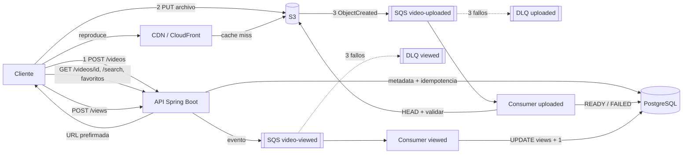

# Video Platform — Challenge técnico IOL

Backend de una plataforma de videos (inspirado en el cap. 14 de *System Design Interview*, Alex Xu), acotado a un alcance que se puede hacer bien: **subir, buscar, reproducir y marcar favoritos**, con foco en un diseño claro, **colas** e **idempotencia**.

**Stack:** Kotlin · Spring Boot 3 · Spring Data JPA (Hibernate) · PostgreSQL · S3 + SQS (LocalStack en local) · Flyway · Testcontainers.

---

## Índice

1. [Alcance](#1-alcance)
2. [Requisitos](#2-requisitos)
3. [Diseño de alto nivel](#3-diseño-de-alto-nivel)
4. [Decisiones y trade-offs](#4-decisiones-y-trade-offs)
5. [Cuellos de botella y cómo escalar](#5-cuellos-de-botella-y-cómo-escalar)
6. [API](#6-api)
7. [Cómo correrlo](#7-cómo-correrlo)
8. [Tests](#8-tests)
9. [Estructura del código](#9-estructura-del-código)

---

## 1. Alcance

| # | Feature | Descripción |
|---|---------|-------------|
| F1 | Subida de video | Registra metadata en BD, valida el archivo y guarda el contenido en S3. La BD guarda la URL servida por CDN. |
| F2 | Favoritos | Cada usuario marca/desmarca videos como favoritos y los lista. |
| F3 | Buscador | Búsqueda por título con paginación. |
| F4 | Reproducción | Detalle del video con URL de reproducción, cantidad de vistas y metadata. |

**Fuera de alcance:** transcodificación y streaming adaptativo (HLS/DASH), comentarios, likes, recomendaciones, login real (se simula con el header `X-User-Id`), CDN real (URL base configurable), moderación y monetización.

## 2. Requisitos

### Funcionales

**F1 — Subida**
- RF1.1: `POST /videos` crea el registro en `PENDING` y devuelve una **URL prefirmada** de S3.
- RF1.2: El cliente sube el archivo **directo a S3**; el binario nunca pasa por el backend.
- RF1.3: Al aparecer el objeto, S3 publica una notificación en la cola `video-uploaded`. Un consumer valida el archivo y pasa el video a `READY` o `FAILED` (con motivo).
- RF1.4: Validaciones: tipo permitido (`video/mp4`, `video/webm`, `video/quicktime`), tamaño máximo (2 GB), tamaño y tipo reales iguales a los declarados, título obligatorio (≤ 200).
- RF1.5: Se guarda la clave de S3 y la URL pública (CDN).
- RF1.6: Un `PENDING` cuyo archivo nunca llega expira (`FAILED / UPLOAD_EXPIRED`) a las 24 h.
- RF1.7: `POST /videos` es idempotente con el header `Idempotency-Key`: reintentar con la misma clave devuelve el mismo video y una URL prefirmada vigente, sin crear duplicados. La misma clave con otro payload devuelve `409`.
- RF1.8: El consumer es idempotente: un mensaje entregado dos veces no tiene efectos duplicados ni retrocede el estado.
- RF1.9: Los mensajes que fallan se reintentan y, tras 3 recepciones, van a la DLQ `video-uploaded-dlq`.

**F2 — Favoritos**
- RF2.1/2.2: Agregar (`PUT`) y quitar (`DELETE`) son idempotentes.
- RF2.3: Listado paginado (`page` y `size`), del más reciente al más antiguo.
- RF2.4: Solo se pueden marcar videos `READY`.

**F3 — Buscador**
- RF3.1: Búsqueda por texto (`q`) sobre el título, sin distinguir mayúsculas, solo videos `READY`.
- RF3.2: Resultados del más reciente al más antiguo, con la paginación estándar de Spring (`page` y `size`).

**F4 — Reproducción**
- RF4.1: Detalle con metadata, URL de reproducción (solo si está `READY`), vistas y si es favorito del usuario que consulta. Un video no `READY` solo lo ve su dueño.
- RF4.2: `POST /videos/{id}/views` publica un evento en la cola `video-viewed` y responde `202`, sin tocar el contador en la ruta caliente.
- RF4.3: Un consumer procesa cada evento y suma 1 al contador, de forma idempotente (dedupe por `eventId`).

### No funcionales

- **Escala:** millones de usuarios y videos; lecturas ≫ escrituras.
- **Disponibilidad:** lectura (búsqueda y reproducción) altamente disponible; el contador de vistas es eventualmente consistente.
- **Consistencia:** estado de video y favoritos consistentes, con PostgreSQL como fuente de verdad.
- **Idempotencia:** creación de video, favoritos y ambos consumers soportan reintentos.
- **Mensajería:** entrega *at-least-once*, consumers idempotentes que no asumen orden, reintentos por *visibility timeout* y DLQ.
- **Eficiencia:** el backend nunca transporta el binario del video.
- **Seguridad:** URLs prefirmadas con expiración corta y tamaño firmado, validación de tipo y tamaño, un video no `READY` solo lo ve su dueño.
- **Operabilidad:** todo corre localmente con `docker compose up`.

### Supuestos

- Usuario identificado por `X-User-Id` (en producción: JWT validado por un gateway o Spring Security).
- Volumen de referencia: 10 M de usuarios activos por mes, 1 M de subidas por mes, 100 M de reproducciones por día, video promedio de 100 MB.

## 3. Diseño de alto nivel

### 3.1 Estimaciones

| Concepto | Cálculo | Resultado |
|----------|---------|-----------|
| Subidas (promedio) | 1 M / (30 × 86 400 s) | ≈ 0,4 /s (pico ×5 ≈ 2 /s) |
| Reproducciones (promedio) | 100 M / 86 400 s | ≈ 1 160 /s (pico ×3 ≈ 3 500 /s) |
| Búsquedas (supuesto 20 M/día) | 20 M / 86 400 s | ≈ 230 /s |
| Storage nuevo | 1 M × 100 MB | ≈ 100 TB/mes ≈ 1,2 PB/año (una sola resolución) |
| Egress (30 MB vistos por reproducción) | 100 M × 30 MB | ≈ 3 PB/día ≈ 35 GB/s ≈ 280 Gbps |
| Tabla `videos` | 12 M filas/año × ~1 KB | ≈ 12 GB/año |
| Tabla `user_favorites` | 10 M usuarios × 50 × ~100 B (con índice) | ≈ 50 GB |
| Eventos de vista | ~1 160 /s | ~1 160 UPDATE/s (en la cola, ya fuera de la request) |

**Qué dicen los números:**
- El **egress** (≈ 3 PB/día) es el costo dominante y justifica un **CDN**: el origen (S3) solo ve los *cache miss*.
- La **metadata es chica** (decenas de GB): una instancia de PostgreSQL con réplicas de lectura alcanza por mucho tiempo.
- El **QPS de escritura de vistas** (~1 200/s sobre muy pocas filas calientes) es el punto que justifica la cola: la request solo publica un evento.
- Las **subidas son poco frecuentes** (~0,4–2 /s): el cuello de botella son los bytes, no las requests, y por eso la subida va directo a S3.

### 3.2 Arquitectura



El API y los dos consumers viven en el mismo servicio (se pueden separar sin cambiar el diseño): los consumers son beans con `@Scheduled` y long polling.

### 3.3 Flujo de vistas

```
POST /videos/{id}/views → 202 → SQS video-viewed → consumer (un mensaje a la vez, idempotente) → UPDATE views = views + 1
```

## 4. Decisiones y trade-offs

**Subida con URL prefirmada.** El binario va directo del cliente a S3.
*Ganamos:* el backend no es cuello de botella de ancho de banda ni de memoria, y escala solo.
*Pagamos:* el video queda en `PENDING` hasta que se valida de forma asíncrona, y hay que limpiar los `PENDING` huérfanos (job de expiración). Además la firma incluye `Content-Type` y `Content-Length`, así que S3 rechaza lo que no coincida, y el consumer vuelve a validar porque la firma no cubre todo (p. ej. un objeto subido por otra vía).

**Validación por evento de S3 → SQS** (en lugar de un endpoint `/complete`). El cliente no puede "mentir" confirmando una subida que no ocurrió, y se desacopla el procesamiento: un pico de subidas se acumula en la cola en vez de tumbar la API. *Costo:* eventual consistencia (el video pasa a `READY` unos instantes después de la subida); el cliente consulta `GET /videos/{id}`.

**Idempotencia en tres niveles:**
1. *API:* `Idempotency-Key` + tabla `idempotency_keys` con PK `(user_id, key)` y hash del payload. Se inserta en la misma transacción que el video, así que no puede existir una clave sin video. Dos requests concurrentes con la misma clave: la PK serializa, una gana y la otra devuelve el resultado de la primera.
2. *Consumers:* `processed_events` con PK `(consumer, event_id)` insertado **en la misma transacción** que el efecto. Si la transacción falla, se revierte también la marca y el reintento procesa normalmente.
3. *Transiciones de estado condicionales* (`WHERE status = 'PENDING'`): ni un duplicado ni un evento tardío pueden retroceder un estado.

**Contador de vistas con write-behind.** Un `UPDATE views = views + 1` dentro de cada request obliga a escribir sobre la misma fila desde miles de requests (contención de locks y latencia en la ruta de lectura). Con la cola, la reproducción solo publica un evento y responde `202`; un consumer lo aplica fuera de la request. *Costo:* el contador es eventualmente consistente (segundos de retraso) y hay una cola más que operar. *Límite conocido:* se hace un `UPDATE` por evento; con un video viral convendría agrupar eventos por video en lotes o acumular en Redis (ver siguientes pasos).

**Búsqueda simple por título.** Un método del repositorio que Spring Data resuelve solo por su nombre (`findByStatusAndTitleContainingIgnoreCase`): el título contiene el texto, sin distinguir mayúsculas, solo videos `READY`. No hay query escrita a mano, y Spring escapa `%` y `_` para que se busquen literalmente. *Límite:* un "contiene" no puede usar un índice común (recorre la tabla), no busca en la descripción y no hay ranking por relevancia ni tolerancia a typos. A este volumen no importa; ver [escalado](#5-cuellos-de-botella-y-cómo-escalar) para el siguiente paso.

**Paginación estándar de Spring (`Pageable`).** Spring resuelve `?page=0&size=20` desde la URL (con `size` máximo 50) y la respuesta es el formato estándar `{ content, page: { size, number, totalElements, totalPages } }`. Los repositorios de Spring Data devuelven directamente un `Page` (con su `COUNT`). El `sort` del cliente se ignora a propósito: el servicio solo toma `page` y `size` y fija el orden, para que el cliente no pueda ordenar por una columna arbitraria. *Costo:* `OFFSET` se vuelve más lento en páginas muy profundas y hace un `COUNT` por request; con un tope de 50 por página y consultas típicas es aceptable. La alternativa a escala es paginación por cursor (*keyset*).

**JPA híbrido: JPA para lo simple y SQL nativo para lo crítico.**
- *JPA / Spring Data* para guardar videos, buscar por id o clave, comprobar existencia y las consultas paginadas (búsqueda y favoritos): menos código y `Page` nativo, sin escribir `LIMIT/OFFSET` ni el `COUNT`.
- *SQL nativo* (`@Query(nativeQuery = true)`) en las operaciones donde importa exactamente qué se ejecuta: `INSERT … ON CONFLICT DO NOTHING` (favoritos), y los `UPDATE` atómicos y condicionales (`PENDING → READY/FAILED`, expiración y `views = views + n`). Cada una es una sola sentencia atómica.
- *Por qué no mutar la entidad:* con una entidad cargada, un `save` posterior podría pisar el contador de vistas o retroceder un estado con datos viejos. Por eso las entidades son de solo lectura tras el alta (campos `val`, `views` con `updatable = false`) y los cambios van por `UPDATE` condicionales.
- *Idempotencia y eventos procesados* también son entidades JPA (`IdempotencyKey`, `ProcessedEvent`): se leen con Spring Data (`findById`, `existsBy…`, borrado por antigüedad en JPQL) y el alta es un `INSERT` nativo de una línea, para que un duplicado falle siempre (clave de idempotencia) o se ignore (`ON CONFLICT DO NOTHING`, eventos). Ya no se usa `JdbcTemplate`.
- Hibernate no gestiona el esquema (`ddl-auto: none`): lo hace Flyway.

**Reintentos y DLQ.** Un mensaje se borra de la cola solo si se procesó bien. Si falla, no se borra: SQS lo vuelve a entregar cuando vence su *visibility timeout* (30 s) y, tras `maxReceiveCount = 3` recepciones, lo mueve a la DLQ. Un mensaje inválido (*poison message*) no bloquea al resto. *Límite conocido:* el reintento es a intervalo fijo; un backoff exponencial se logra cambiando la visibilidad según `ApproximateReceiveCount` (ver siguientes pasos).

**Códigos de error:** `400` request mal formada, `404` no existe o no es visible para el usuario, `409` reuso de `Idempotency-Key` con otro payload, `422` regla de negocio (tipo o tamaño no permitido).

## 5. Cuellos de botella y cómo escalar

| Punto | Problema a escala | Mitigación |
|-------|-------------------|------------|
| Egress de video | ≈ 3 PB/día | CDN (CloudFront) delante de S3 con cache largo; el origen solo ve los *miss*. Es la palanca más grande de costo. |
| `processed_events` de vistas | 100 M eventos/día ≈ 10 GB/día: **no es viable** como mecanismo de dedupe | Para vistas el dedupe exacto no es necesario: usar Redis (`SET NX` con TTL) o aceptar un conteo aproximado; dejar `processed_events` para los consumers de baja frecuencia (subidas). Acortar retención a la ventana real de reentrega. |
| Contador de vistas | Fila caliente para videos virales | Ya sale de la ruta de la request; siguientes pasos: agrupar eventos por video en lotes, o acumular en Redis (`INCRBY`) y volcar a BD periódicamente. |
| Búsqueda | El "contiene" sobre el título recorre la tabla; sin relevancia ni typo-tolerance | Primer paso: full-text de Postgres (`tsvector` + índice GIN) o `pg_trgm`. A gran escala: OpenSearch/Elasticsearch alimentado por eventos (`video-ready`), con Postgres como fuente de verdad. |
| Paginación | `OFFSET` lento en páginas profundas y `COUNT` en cada request | Paginación por cursor (*keyset*) y sin total exacto; limitar la profundidad. |
| Lecturas de detalle | Pico de lecturas sobre `videos` | Réplicas de lectura + cache (Redis) de `GET /videos/{id}` con invalidación por evento. |
| Consumers | Un solo proceso hace el polling | Escalar horizontal: SQS reparte los mensajes entre instancias; la idempotencia ya soporta concurrencia. |
| Datos | `videos` y favoritos crecen sin límite | Particionar `user_favorites` por hash de `user_id`; archivar videos viejos. |
| Subidas grandes | Una sola URL prefirmada no reanuda | *Multipart upload* de S3 con URLs prefirmadas por parte (reanudable). |

## 6. API

Todos los endpoints requieren el header `X-User-Id`.

| Método | Ruta | Descripción |
|--------|------|-------------|
| `POST` | `/videos` | Crea el registro `PENDING` y devuelve URL prefirmada. Header `Idempotency-Key` obligatorio. `201` la primera vez, `200` en reintento. |
| `GET` | `/videos/{id}` | Detalle: metadata, `playbackUrl` (si `READY`), vistas, `favorite`. También sirve para ver el estado de la subida. |
| `POST` | `/videos/{id}/views` | Registra una reproducción. `202`. |
| `GET` | `/videos/search?q=&page=&size=` | Buscador paginado (`page` desde 0, `size` por defecto 20, máx. 50). |
| `PUT` | `/users/me/favorites/{videoId}` | Agrega a favoritos (idempotente). `204`. |
| `DELETE` | `/users/me/favorites/{videoId}` | Quita de favoritos (idempotente). `204`. |
| `GET` | `/users/me/favorites?page=&size=` | Lista de favoritos paginada. |

**Crear video**

```http
POST /videos
X-User-Id: maxi
Idempotency-Key: 6f1c2f1e-5a5a-4c8e-9d52-1d5f0a1b2c3d
Content-Type: application/json

{ "title": "Mi primer video", "description": "demo", "fileName": "clip.mp4",
  "contentType": "video/mp4", "sizeBytes": 1048576 }
```

```json
{
  "videoId": "0b0c8e3a-3d8f-4f51-9d57-7d1c0a3c2f10",
  "status": "PENDING",
  "upload": {
    "url": "http://localhost:4566/video-bucket/videos/0b0c…/clip.mp4?X-Amz-…",
    "method": "PUT",
    "headers": { "content-type": "video/mp4" },
    "expiresAt": "2026-11-23T18:15:00Z"
  }
}
```

**Búsqueda / favoritos** devuelven el formato de página estándar de Spring:

```json
{
  "content": [ { "id": "…", "title": "Mi primer video", "views": 3, "playbackUrl": "…", "createdAt": "…" } ],
  "page": { "size": 20, "number": 0, "totalElements": 1, "totalPages": 1 }
}
```

## 7. Cómo correrlo

**Requisitos:** JDK 17+ y Docker.

```bash
# 1) Infraestructura local: PostgreSQL + LocalStack (S3 y SQS)
docker compose up -d

# 2) La aplicación (al arrancar crea bucket, colas, DLQ y la notificación S3 -> SQS)
./gradlew bootRun
```

**Demo de punta a punta**

```bash
KEY=$(uuidgen)
head -c 1048576 /dev/urandom > /tmp/clip.mp4     # el archivo debe pesar exactamente sizeBytes

# 1. Crear el video y obtener la URL de subida
curl -s -X POST localhost:8080/videos \
  -H 'X-User-Id: maxi' -H "Idempotency-Key: $KEY" -H 'Content-Type: application/json' \
  -d '{"title":"Mi primer video","description":"demo","fileName":"clip.mp4","contentType":"video/mp4","sizeBytes":1048576}'

# 2. Subir el archivo a la URL prefirmada (reemplazar <URL> por upload.url)
curl -X PUT '<URL>' -H 'Content-Type: video/mp4' --data-binary @/tmp/clip.mp4

# 3. Esperar un instante y consultar: debe estar READY
curl -s localhost:8080/videos/<VIDEO_ID> -H 'X-User-Id: maxi'

# 4. Buscar, reproducir (vistas) y favoritos
curl -s 'localhost:8080/videos/search?q=primer' -H 'X-User-Id: ana'
curl -s -X POST localhost:8080/videos/<VIDEO_ID>/views -H 'X-User-Id: ana'
curl -s -X PUT  localhost:8080/users/me/favorites/<VIDEO_ID> -H 'X-User-Id: ana'
curl -s localhost:8080/users/me/favorites -H 'X-User-Id: ana'
```

Si se reintenta el paso 1 con la misma `Idempotency-Key` devuelve el mismo `videoId` (`200`). Para ver el flujo de errores, subir un archivo de otro tamaño o content-type directo a S3 deja el video en `FAILED` con el motivo.

**Swagger / OpenAPI:** con la app corriendo, UI en <http://localhost:8080/swagger-ui.html> y especificación en `/v3/api-docs` (springdoc). Cada endpoint trae descripción, headers documentados y **ejemplos de respuesta** (éxito y errores); los endpoints están numerados en el orden de uso y la descripción general explica el flujo completo. Todos llevan `X-User-Id`; en la UI se completa en cada request. La subida del archivo es un `PUT` directo a S3, así que no se puede hacer desde Swagger: se usa el `curl` que figura en la descripción. En los endpoints paginados se ignora `sort`: el orden es fijo.

**Postman:** importar `postman/video-platform.postman_collection.json` y `postman/video-platform.local.postman_environment.json`. Correr en orden: 1 crear (guarda `videoId` y `uploadUrl`, genera la `Idempotency-Key`) → 2 reintento (`200`) → 3 subir a S3 (en *Body → binary* elegir un archivo cuyo tamaño en bytes sea igual a la variable `sizeBytes`) → 4 detalle (repetir hasta `READY`) → 5 buscar → 6 view → favoritos. La carpeta *Casos de error* cubre `400`, `422`, `409` y `404`.

**Puertos:** PostgreSQL se publica en `5433` (host) para no chocar con un Postgres local en `5432`, y LocalStack en `4566`. Si algún puerto ya está ocupado (`docker ps`), bajá el otro contenedor o cambiá el puerto en `docker-compose.yml` y en `DB_URL`.

**Configuración:** `src/main/resources/application.yml`. Con `AWS_PROVISION=false` y credenciales/endpoint reales de AWS, la aplicación asume que bucket, colas y notificación ya existen (infraestructura como código).

> LocalStack se fija en `3.8.1` (versión community sin token). Las imágenes más nuevas pueden requerir cuenta.

## 8. Tests

```bash
./gradlew test              # TODOS: unitarios + integración (requiere Docker)
./gradlew unitTest          # solo unitarios (rápidos, sin Docker)
./gradlew integrationTest   # solo integración de punta a punta (requiere Docker)
```

## 9. Estructura del código

```
src/main/kotlin/com/videoplatform/
├── config/            AppProperties, clientes AWS, provisión de bucket/colas/DLQ, OpenAPI
├── domain/
│   ├── entity/        entidades JPA: Video, UserFavorite, IdempotencyKey, ProcessedEvent (+ sus ids compuestos)
│   ├── model/         VideoStatus, VideoSummary, FavoriteItem, StoredObject, PresignedUpload, ValidationResult
│   ├── exception/     NotFound (404), Conflict (409), InvalidRequest (400), Unprocessable (422)
│   ├── validation/    UploadValidator (valida el archivo subido contra lo declarado)
│   └── util/          RequestHasher
├── persistence/       repositorios Spring Data JPA (JPA para lo simple, @Query nativo para lo atómico)
├── storage/           VideoStorage (interfaz) + S3VideoStorage (URL prefirmada, HEAD)
├── messaging/
│   ├── event/         S3ObjectCreated, ViewedEvent
│   ├── publisher/     ViewEventPublisher (interfaz) + SqsViewEventPublisher
│   ├── consumer/      pollers SQS y handlers idempotentes
│   └── support/       S3EventParser
├── service/           casos de uso (videos, favoritos, búsqueda, vistas, jobs de mantenimiento)
│   ├── command/       CreateVideoCommand
│   └── result/        CreateVideoResult, VideoDetail
└── web/
    ├── controller/    controllers REST (con anotaciones OpenAPI)
    ├── request/       CreateVideoRequest
    ├── response/      CreateVideoResponse, UploadInstructions, VideoDetailResponse
    └── error/         ErrorHandler, ErrorBody
postman/           colección y environment para probar la API
```

Convención: una clase de datos por archivo, en el paquete donde se usa (los comandos y resultados en `service/`, los eventos en `messaging/`, los DTOs en `web/`). Excepción deliberada: las clases anidadas de configuración quedan dentro de `AppProperties`. Las interfaces y sus implementaciones van en archivos separados.

La dependencia fluye `web → service → persistence/storage/messaging`; el dominio no depende de Spring ni de AWS (solo de las anotaciones de JPA en las entidades), y el storage y el publisher de eventos están detrás de interfaces.

